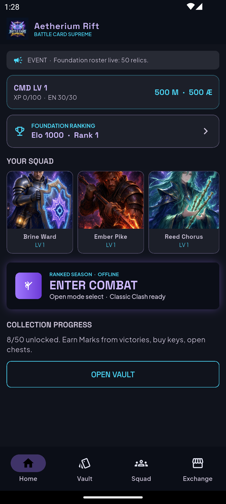
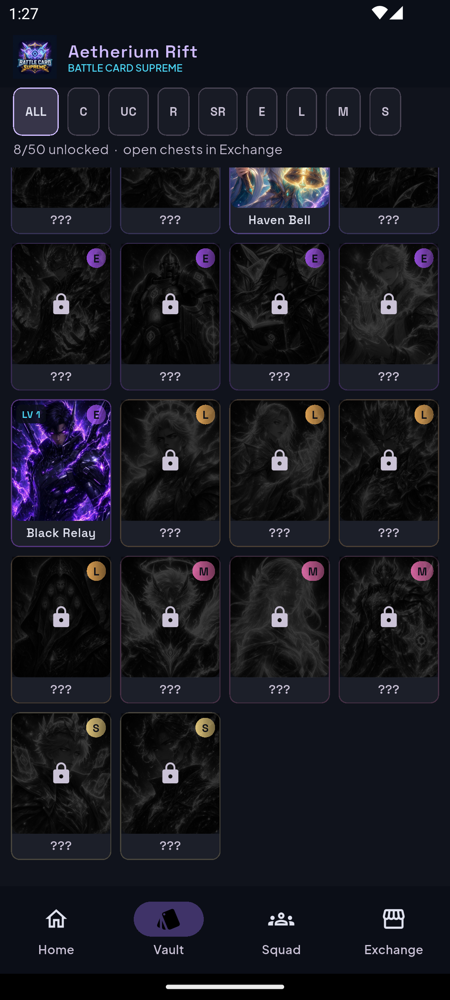
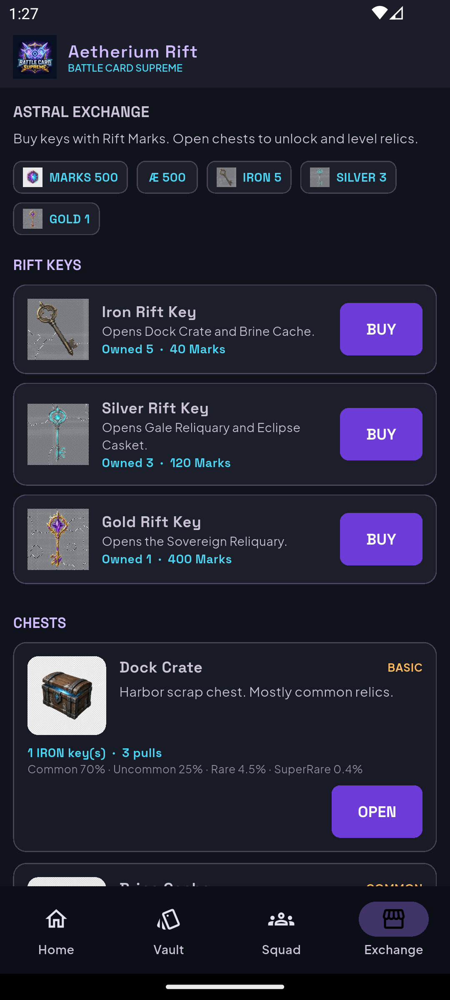
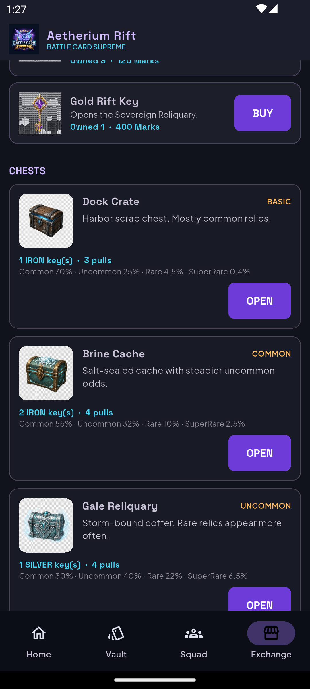
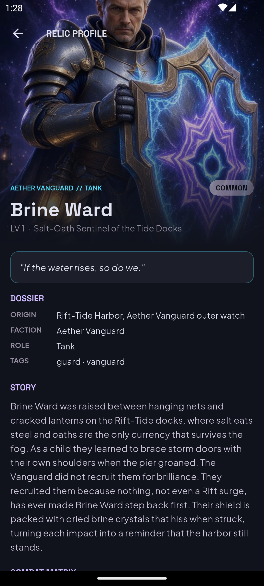
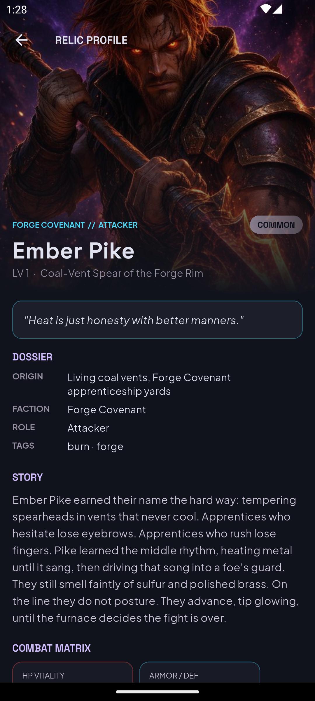
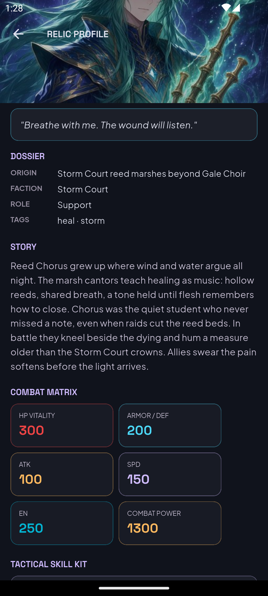
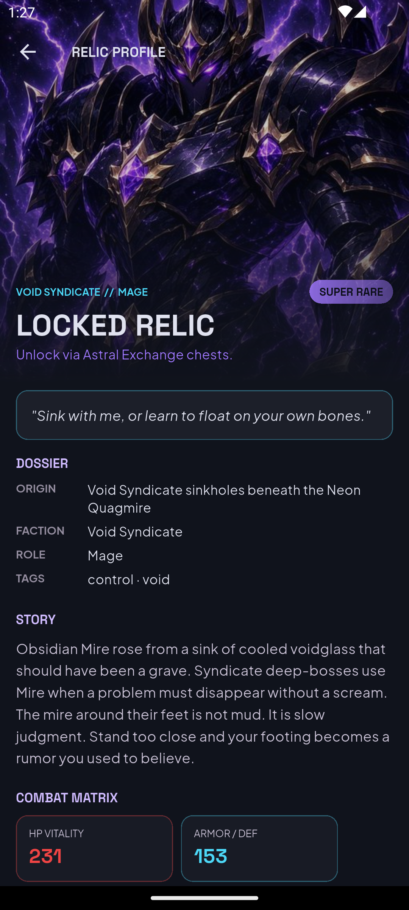

# Battle Card Supreme

**Aetherium Rift** collectible card battler — Flutter client + Laravel Sanctum API.

Owned and maintained by **[Tahsan](https://github.com/Tahsan0619)** ([@Tahsan0619](https://github.com/Tahsan0619)).

Fifty original relics, locked vault progression, Astral Exchange chests/keys, squad combat, and foundation ranking.

---

## Demo login

| Field | Value |
|-------|-------|
| Email | `commander@bcs.test` |
| Password | `Password1!` |

Starter economy on this account (dev): **500 Rift Marks**, iron/silver/gold keys, and several unlocked relics so Exchange and hero profiles are usable immediately.

Emulator API base: `http://10.0.2.2:8000`  
(Override with `--dart-define=BCS_API_BASE=...`)

---

## Screens tour

Bottom navigation has four roots: **Home · Vault · Squad · Exchange**. Login, Relic Profile, Battle Modes, Ranking, Prep, and Combat open as stacked routes on top.

### Home

Command hub: level/XP/energy, Marks & Æther, foundation Elo/rank, **YOUR SQUAD** (tap a portrait for Relic Profile), **ENTER COMBAT**, and collection progress into the Vault.



### Vault

4-column catalogue of all 50 relics. Unlocked cards show art + level; locked cards stay silhouetted with `???` until opened from Exchange. Rarity filters: ALL / C / UC / R / SR / E / L / M / S. Tap an unlocked tile for Relic Profile.



### Squad

Build the 3-card tactical team from **owned** relics only. Locked codes cannot be slotted. Start battle from here or Home.

*(Use the Squad tab in-app — same dark Aetherium chrome as Home/Vault.)*

### Astral Exchange

Economy screen: buy **Iron / Silver / Gold Rift Keys** with Marks, then **OPEN** chests. Rates are disclosed per chest. Opening plays a shake → glow burst → staggered reward reveal.





| Chest | Key | Notes |
|-------|-----|--------|
| Dock Crate | 1 Iron | Basic commons-heavy |
| Brine Cache | 2 Iron | Stronger uncommon odds |
| Gale Reliquary | 1 Silver | Rare weighting |
| Eclipse Casket | 3 Silver | Epic-leaning |
| Sovereign Reliquary | 1 Gold | Legendary → Supreme possible |

### Relic Profile (hero details)

Full dossier for a relic: cinematic art, rarity, level, quote, origin/faction/role/tags, story, combat matrix (HP / DEF / ATK / SPD / EN / power), and skill kit. Unlocked heroes show level; locked profiles prompt Exchange unlock.

**Unlocked examples (demo squad):**







**Locked profile example** (art + lore visible; combat unlock gated):



### Commander Access (login / register)

Required for Exchange, online clash, ranking sync, and cloud collection. Register creates a profile, starter commons, and ranking seed.

### Foundation Ranking

Leaderboard of Elo and rank. Reachable from the ranking card on Home.

### Battle Modes

Mode select after **ENTER COMBAT**: Classic Clash (offline), Survival, Online Card Clash / PvP queue (auth required).

### Battle Prep → Combat → Result

Confirm the 3-card squad, fight turn-based combat (abilities, shields, energy), then claim victory rewards (Marks; chance at Iron keys) on the result screen.

---

## Repo layout

| Path | Purpose |
|------|---------|
| `battle_card_supreme/` | Flutter + Riverpod client |
| `api/` | Laravel Sanctum API (auth, catalogue, collection, chests, PvP, ranking) |
| `docs/` | GDD / architecture notes + `screenshots/` |
| `Design Prefer/` | Mandatory UI references |
| `Master_Prompt.md` | Production contract |
| `scripts/` | Roster export / MySQL helpers |

---

## Quick start

```powershell
# MySQL (XAMPP) if needed
powershell -ExecutionPolicy Bypass -File .\scripts\start_mysql.ps1

# API
cd api
copy .env.example .env   # first time — set DB_* then:
php artisan key:generate
php artisan migrate --seed
php artisan serve --host=0.0.0.0 --port=8000

# Client
cd ..\battle_card_supreme
flutter pub get
flutter run
```

```bash
cd battle_card_supreme && flutter test
```

---

## Stack highlights

- **Client:** Flutter, Riverpod, Google Fonts, offline combat + online sync  
- **API:** Laravel, Sanctum tokens, integer Elo, chest RNG with disclosed rates, idempotent opens  
- **Art:** Generated portraits (`assets/art/portraits/`), brand logo, key/chest/currency icons  
- **Progression:** Ownership via chests · card levels from duplicate copies · Marks from wins  

---

## License

© Tahsan. **Battle Card Supreme / Aetherium Rift** is licensed under [Creative Commons Attribution 4.0 International (CC BY 4.0)](https://creativecommons.org/licenses/by/4.0/).

You are free to share and adapt the material for any purpose, even commercially, as long as you give appropriate credit to **Tahsan**, provide a link to the license, and indicate if changes were made. See `LICENSE` for the full legal text.

Screenshots under `docs/screenshots/` are from the Android emulator demo build.
